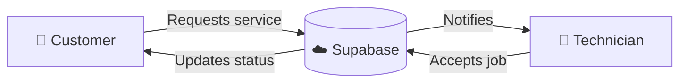

<!-- ═══════════ HEADER ═══════════ -->
<div align="center">


<a href="https://github.com/ahmedreda376">
  
</a>

<br/>


</div>

---

## 👨‍💻 About Me


```dart
class AhmedReda extends FlutterDeveloper {
  final String role      = 'Flutter Developer 📱';
  final String country   = 'Egypt 🇪🇬';
  final List<String> stack = [
    'Flutter', 'Dart', 'BLoC / Cubit', 'Provider',
    'Supabase', 'Firebase', 'Dio', 'Hive',
  ];
  final String mindset   = 'Clean code • Good architecture • Scalable apps';

  @override
  Widget build(BuildContext context) {
    return const Text('Always Learning. Always Building. 🚀');
  }
}
```

- 📱 I turn ideas into **modern, scalable, user-friendly** mobile apps
- 🧱 Strong **OOP**, **Clean Architecture** & **SOLID** principles
- ⚡ State management with **BLoC, Cubit & Provider**
- 🌐 REST APIs using **HTTP & Dio**
- ☁️ Backend with **Firebase** & **Supabase**
- 💾 Local storage with **Hive** & **SharedPreferences**
- 🌍 Apps with **Arabic & English** localization

<br clear="right"/>

---

## 🚀 Featured Project

<div align="center">

### 🛠️ Sanad — Home Maintenance Services App

*A service marketplace that connects customers with professional technicians.*


</div>

<table align="center">
  <tr>
    <td>

**✨ Key Features**

- 🔐 User Authentication & Registration
- 📲 Phone Verification using OTP
- 📍 Automatic Location Detection
- 🏠 Address Selection & Management
- 👥 Separate Customer & Provider Roles
- 📋 Maintenance Request Management
- 🌍 Arabic & English Localization
- 📐 Responsive UI for all screen sizes

</td>
<td>

**🧰 Service Categories**

- ⚡ Electrical Maintenance
- 🚰 Plumbing Services
- 🪚 Carpentry Services
- 🔥 Gas Services
- 🧰 Other Home Services

**🏗️ Built With**

`Flutter` `Dart` `Cubit/BLoC` `Supabase`

</td>
  </tr>
</table>



---

## 🛠️ Tech Stack

<div align="center">


<br/><br/>


</div>

---

## 📊 GitHub Stats

<div align="center">


<br/>


<br/>


</div>

---

## 📈 Contribution Activity

<div align="center">


<br/><br/>

### 🐍 Contribution Snake


</div>

---

## 📚 Currently Learning

<div align="center">

| 🎯 Topic | 📈 Progress |
|:--|:--|
| 🏗️ Advanced Clean Architecture |  |
| 🧪 Unit & Widget Testing |  |
| 💉 Dependency Injection (GetIt) |  |
| 🧩 Design Patterns |  |
| 🔄 CI/CD |  |
| ⚡ Performance Optimization |  |

</div>

---

## 🎯 Goals

- 🚀 Build **production-ready** mobile applications
- 🛒 Publish apps on **Google Play Store**
- 🧠 Improve software engineering & problem-solving skills
- 🤝 Contribute to **Open Source** projects
- 👑 Grow as a **Professional Flutter Developer**

---

## 🌐 Let's Connect

<div align="center">

<a href="https://github.com/ahmedreda376">
  
</a>
<a href="https://www.linkedin.com/in/ahmed-reda-67575a3aa">
  
</a>

<br/><br/>


</div>
