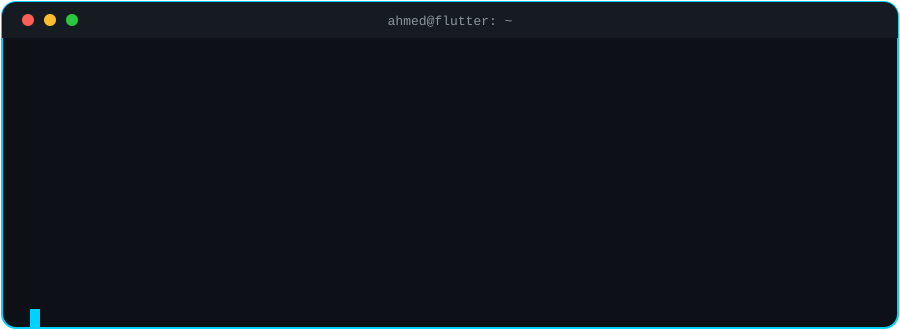
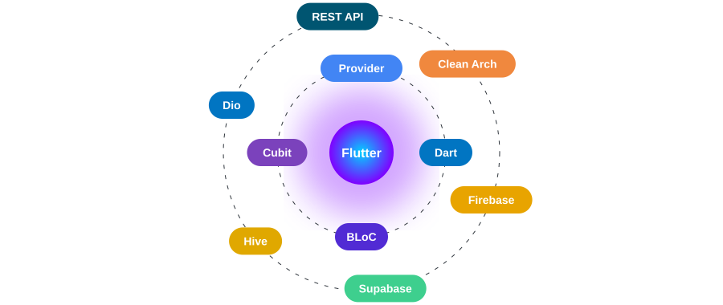
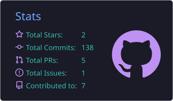
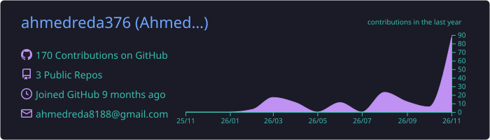
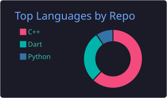
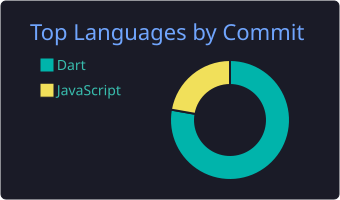
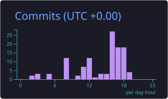
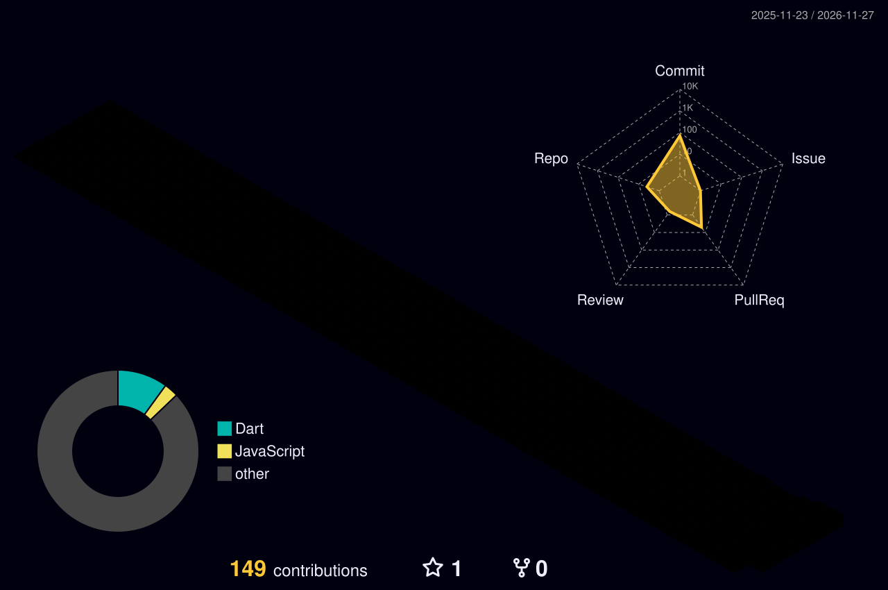

 

<h3>📁 My Repositories</h3>

 

 

 

 

<h3>📈 More Stats</h3>

<!-- Summary cards (generated by the workflow in .github/workflows/stats.yml) -->

 

 

 

  

<!-- Isometric 3D contributions -->

<picture>
<source media="(prefers-color-scheme: dark)" srcset="https://raw.githubusercontent.com/ahmedreda376/ahmedreda376/output/github-snake-dark.svg"/>
<source media="(prefers-color-scheme: light)" srcset="https://raw.githubusercontent.com/ahmedreda376/ahmedreda376/output/github-snake.svg"/>

</picture>

<!-- Pacman contribution graph -->

  

