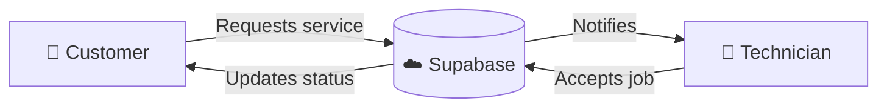

- 📱 I'm **Ahmed Reda**, a Flutter developer passionate about building useful and user-friendly mobile applications.
- ✨ I enjoy turning ideas into clean, maintainable, and responsive Flutter experiences.
- 🧰 I work with **Dart, Flutter, BLoC/Cubit, Provider, REST APIs, Firebase, and Supabase**.
- 🧠 I care about readable code, thoughtful architecture, and continuous improvement.
- 🌱 Currently deepening my knowledge of **Clean Architecture, testing, and advanced Flutter development**.

### 🛠️ Sanad | Home Maintenance Services App

A service marketplace that connects customers with professional technicians to request and manage home maintenance services.

| ⚡ Electrical | 🚰 Plumbing | 🪚 Carpentry | 🔥 Gas | 🧰 Other Services |
|:-:|:-:|:-:|:-:|:-:|

  

<b>More about my development toolkit</b>

- **State Management:** BLoC, Cubit, Provider
- **Networking:** REST APIs, HTTP, Dio
- **Local Storage:** Hive, SharedPreferences
- **Concepts:** OOP, SOLID principles, Clean Architecture
- **Workflow:** Git, GitHub, debugging, responsive UI

 

 

### 🐍 Contribution Snake

<picture>
<source media="(prefers-color-scheme: dark)" srcset="https://raw.githubusercontent.com/ahmedreda376/ahmedreda376/output/github-snake-dark.svg"/>
<source media="(prefers-color-scheme: light)" srcset="https://raw.githubusercontent.com/ahmedreda376/ahmedreda376/output/github-snake.svg"/>

</picture>

 
 
 
 

 

  

